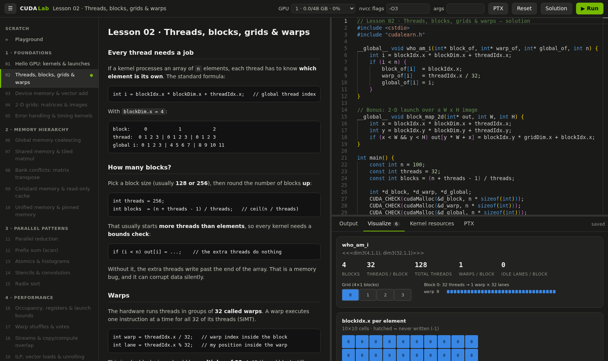

# CUDA Lab

A hands-on course for learning **CUDA C++ from scratch**, from your first kernel to tensor cores and
flash-attention-style kernels. It comes with a small browser IDE that compiles your code with `nvcc`, runs it on a
real GPU, and **visualizes what the GPU did**: thread/block layouts, data, timings, bandwidth and register usage.



## Features

- **Lesson + editor side by side.** Each lesson has the theory, a starter file with TODOs, and a reference solution.
- **One-click compile & run** (`Ctrl+Enter`) on a GPU you pick from a dropdown that shows live memory use.
  nvcc errors are underlined on the right line.
- **Visualize tab.** Call `viz::` helpers from your C++ code to get charts:
  - the launch layout: the grid of blocks, plus one block broken into warps × 32 lanes, with idle lanes marked
  - array bar/line charts and matrix heatmaps
  - "which block / warp touched this element" label grids
  - timing comparisons with speedup, and memory bandwidth vs the GPU's peak
- **Kernel resources tab.** Shows registers per thread, shared/constant memory, stack and spills (from
  `ptxas -v`), and how many threads the registers allow to be resident on an SM.
- **PTX tab.** Shows the virtual assembly nvcc generates for your kernels.
- **Autosave.** Your code lives in `my-work/`, separate from the lesson templates.
- **Terminal workflow too.** `./run.sh file.cu` compiles and runs any file.

## Requirements

- Linux with an NVIDIA GPU and driver
- CUDA toolkit (`nvcc`). Developed with CUDA 12.4 on RTX A6000 (`sm_86`).
- Python 3.10+ with `fastapi`, `uvicorn` and `pydantic`
- A browser with internet access. The editor (Monaco) and markdown renderer load from a CDN. If Monaco can't
  load, the IDE falls back to a plain text editor.

## Quick start

```bash
git clone https://github.com/nlpkiddo-2001/cuda-lab.git
cd cuda-lab
pip install fastapi uvicorn pydantic      # if your Python doesn't have them yet
./start.sh                                # → http://127.0.0.1:8090
```

On a remote GPU server, forward the port instead of exposing it. In VS Code, use **Ports → Forward a Port → 8090**.
Or with plain SSH:

```bash
ssh -L 8090:127.0.0.1:8090 you@gpu-server      # then open http://localhost:8090
```

### Configuration

The scripts default to the author's setup. Override with environment variables:

| Variable | Default | Meaning |
|---|---|---|
| `CUDA_ENV` | `/opt/conda/envs/voice-pipeline` | prefix whose `bin/` has `nvcc` + `python` and `lib/` has `libcudart.so` |
| `NVCC` | `nvcc` on `PATH`, else `$CUDA_ENV/bin/nvcc` | compiler to use |
| `CUDA_LIB` | `<nvcc dir>/../lib` | where `libcudart.so` lives |
| `CUDA_ARCH` | `sm_86` | target GPU architecture (`sm_80` A100, `sm_89` RTX 40xx, `sm_90` H100, …) |
| `GPU` (`run.sh` only) | `1` | which GPU `run.sh` runs on |

For a standard toolkit install, something like this should work:
`CUDA_ENV=/usr/local/cuda NVCC=/usr/local/cuda/bin/nvcc CUDA_LIB=/usr/local/cuda/lib64 ./start.sh`
(with `start.sh`'s Python swapped for yours if `/usr/local/cuda/bin/python` doesn't exist).

### Run from the terminal

```bash
./run.sh my-work/01-hello-gpu.cu           # compile + run on GPU 1
GPU=2 ./run.sh lessons/playground.cu       # another GPU
```

In the terminal, `viz::` output prints as raw `@@VIZ {...}` lines. The charts only render in the IDE.

## Curriculum

| Module | Lessons |
|---|---|
| **1 · Foundations** | Hello GPU · Threads, blocks, grids & warps · Device memory & vector add · 2-D grids · Error handling & timing |
| **2 · Memory hierarchy** | Coalescing · Shared memory & tiled matmul · Bank conflicts (transpose) · Constant memory · Unified & pinned memory |
| **3 · Parallel patterns** | Reduction · Scan · Atomics & histograms · Stencils & convolution · Radix sort |
| **4 · Performance** | Occupancy & launch bounds · Warp shuffles & votes · Streams & overlap · ILP & vector loads · CUDA graphs |
| **5 · Advanced** | Cooperative groups · Multi-GPU & P2P · Tensor cores (WMMA) · Fast GEMM · Fused softmax · Flash-attention-style kernel · PyTorch extension |

Lessons are added one at a time as the course progresses. Lessons that haven't been written yet appear greyed out in
the IDE. The full roadmap is in [`lessons/curriculum.json`](lessons/curriculum.json).

## The `cudalearn.h` helpers

Every program can `#include "cudalearn.h"` (it is on the include path automatically):

```cpp
CUDA_CHECK(cudaMalloc(&d, bytes));          // abort with file:line on any CUDA error
kernel<<<blocks, threads>>>(d, n);
KERNEL_CHECK();                             // catch launch errors + errors inside the kernel

GpuTimer t; t.start(); kernel<<<b, t>>>(...); float ms = t.stop();

viz::launch("my kernel", grid, block);      // draw the launch configuration
viz::array("result", h_out, n);             // bar / line chart       (host pointer!)
viz::matrix("C", h_C, rows, cols);          // heatmap
viz::labels("block per element", ids, r, c);// labelled grid; -1 = never written
viz::timing("naive", ms);                   // all timings → one chart with speedups
viz::bandwidth("copy", bytes, ms);          // GB/s vs peak
```

These helpers print `@@VIZ {json}` lines to stdout. The server strips them from the console output and the browser
draws them ([`ide/static/viz.js`](ide/static/viz.js)). To add a chart type, add an emitter to `cudalearn.h` and a
renderer to `viz.js`.

## Project layout

```
start.sh               start the IDE (127.0.0.1:8090)
run.sh                 compile + run a .cu file from the terminal
ide/server.py          FastAPI backend: nvcc compile, run with CUDA_VISIBLE_DEVICES, ptxas parsing, PTX, @@VIZ
ide/static/            browser UI: app.js, viz.js, style.css, index.html
include/cudalearn.h    CUDA_CHECK, KERNEL_CHECK, GpuTimer, viz::
lessons/<id>/          lesson.md, starter.cu, solution.cu
lessons/playground.*   free scratch space
my-work/               your code (autosaved by the IDE)
.toolchain/lib/        empty libcudadevrt.a stub (see below)
```

## Notes & limitations

- **Security.** The IDE compiles and runs whatever code it receives, with no authentication. It binds to
  `127.0.0.1` by default. Don't expose it on a shared network; use port forwarding.
- Runs are killed after **30 s** and compiles after 60 s.
- Some toolkits (like the conda CUDA 12.4 packages this was built on) ship without `libcudart_static.a` or
  `libcudadevrt.a`. The lab links with `-cudart shared` and uses an empty `libcudadevrt.a` stub, so **dynamic
  parallelism / `-rdc=true` is not supported** in that setup.
- Profilers (Nsight Compute/Systems, compute-sanitizer) are not required. Performance lessons use `GpuTimer`,
  bandwidth numbers and `ptxas -v` output, so they work on any machine with nvcc.
